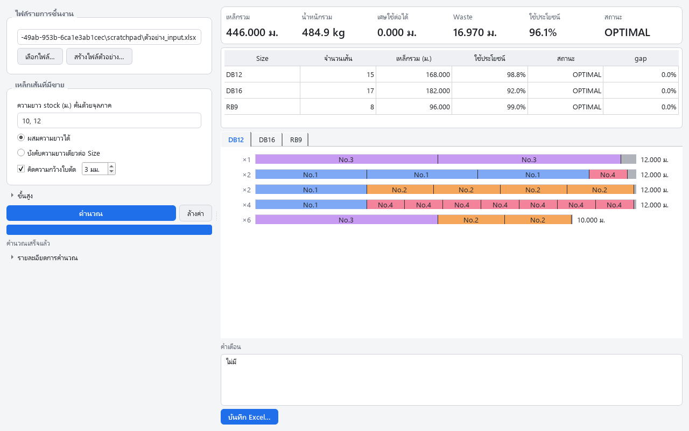
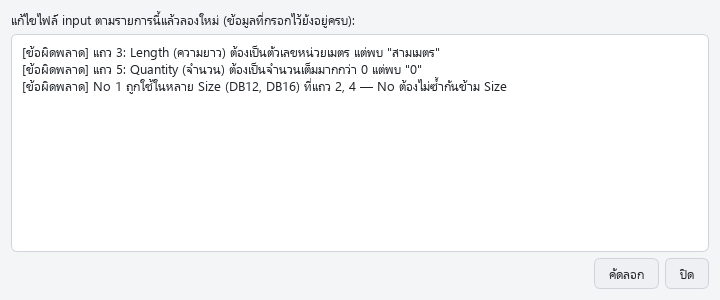
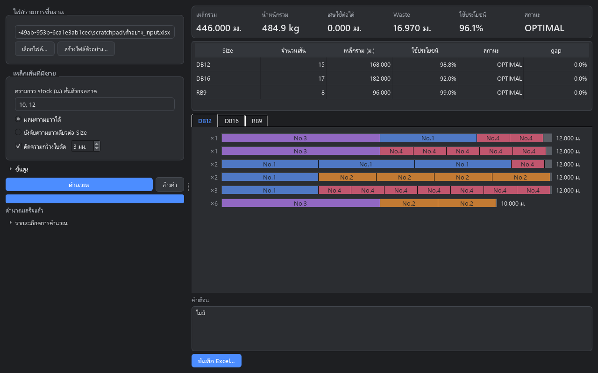

# Rebar Cutting Optimizer v2

โปรแกรม Desktop (Windows) สำหรับวางแผนตัดเหล็กเส้นให้คุ้มที่สุด
(One-dimensional Cutting Stock Problem แบบหลายความยาว stock)
กรอกรายการชิ้นงานใน Excel → โปรแกรมบอกว่าเหล็กแต่ละเส้นตัดเป็นอะไรบ้าง
ต้องซื้อเหล็กยาวเท่าไรกี่เส้น หนักกี่ kg และเหลือเศษที่ใช้ต่อได้เท่าไร



## ติดตั้ง

1. ดาวน์โหลด `RebarOptimizer-<เวอร์ชัน>-win64.zip` (artifact จาก GitHub Actions)
2. แตก zip ไปไว้ที่ใดก็ได้ เช่น `C:\Programs\RebarOptimizer` (ไม่ต้องติดตั้ง Python)
3. ดับเบิลคลิก `RebarOptimizer.exe`

รองรับ Windows 10/11 64-bit การตั้งค่าล่าสุดเก็บที่ `%APPDATA%\RebarOptimizer\settings.json`
และ log อยู่ที่ `%LOCALAPPDATA%\RebarOptimizer\logs\` (แนบไฟล์นี้เมื่อแจ้งปัญหา)

## วิธีใช้

1. **เลือกไฟล์** Excel รายการชิ้นงาน (หรือลากไฟล์มาวางบนหน้าต่าง) ถ้ายังไม่มี กด **สร้างไฟล์ตัวอย่าง**
2. กรอก **ความยาว stock** ที่มีขาย หน่วยเมตร คั่นด้วยจุลภาค เช่น `10, 12`
3. เลือกโหมด **ผสมความยาวได้** (ค่าเริ่มต้น) หรือ **บังคับความยาวเดียวต่อ Size**
4. ติ๊ก **คิดความกว้างใบตัด** ถ้าต้องการเผื่อรอยตัด (มม. ต่อรอย)
5. กด **คำนวณ** (Ctrl+Enter) ระหว่างคำนวณกด **ยกเลิก** (Esc) ได้
6. ดูผล: แถบสรุป ตารางต่อ Size และ **ภาพแผนการตัด** (ชี้เมาส์ที่แถบเพื่อดูรายละเอียด)
7. กด **บันทึก Excel** (Ctrl+S) ถ้าไฟล์เปิดค้างใน Excel ให้ปิดแล้วกดบันทึกซ้ำ ไม่ต้องคำนวณใหม่

ถ้าไฟล์ input มีปัญหา โปรแกรมจะแสดงรายการปัญหาพร้อมเลขแถวใน Excel (คัดลอกได้)
และไม่ล้างค่าที่กรอกไว้



รองรับธีม light/dark ตาม Windows:



## รูปแบบไฟล์ input

ชีตแรก แถวที่ 1 เป็นหัวตาราง (ไม่สนตัวพิมพ์เล็กใหญ่ และใช้ชื่อไทยได้)

| คอลัมน์ | ชื่อไทย | ความหมาย | ตัวอย่าง |
|---|---|---|---|
| `Size` | `ขนาด` | ขนาดเหล็ก ใช้ตัวเลขท้ายชื่อคำนวณน้ำหนัก (d²/162 kg/m) | `DB12`, `RB9` |
| `No` | `หมายเลข` | หมายเลขชิ้นงาน **ห้ามซ้ำข้าม Size** | `1`, `A-12` |
| `Length` | `ความยาว` | ความยาวชิ้นงาน **หน่วยเมตร** | `3.5` |
| `Quantity` | `จำนวน` | จำนวนชิ้น จำนวนเต็มมากกว่า 0 | `12` |

- คอลัมน์อื่นที่เพิ่มมา (เช่น หมายเหตุ) ถูกคัดลอกไปชีต "ข้อมูล Input" แต่ไม่ใช้คำนวณ
- แถวว่างทั้งแถวถูกข้าม เซลล์สูตรที่ยังไม่เคยคำนวณใน Excel ถือเป็นค่าว่าง
- No เดียวกันใน Size เดียวกัน: ความยาวเท่ากัน → รวมจำนวนให้และเตือน, ความยาวต่างกัน → error
- ความยาวทุกแถว ≥ 100 → เตือนว่าหน่วยอาจเป็นมิลลิเมตร
- ชิ้นที่ยาวกว่าเหล็กเส้นที่ยาวที่สุดจะอยู่ในชีต **"วางไม่ได้"** และมีแถบเตือนในโปรแกรม

## ผลลัพธ์ Excel

| ชีต | เนื้อหา |
|---|---|
| แผนการตัด | แบบการตัดแต่ละแบบ จำนวนเส้น รายการชิ้น kerf loss เศษ และเศษนำไปใช้ได้หรือไม่ |
| รายละเอียดการตัด | 1 แถวต่อ (แบบ, No) สำหรับกรอง/pivot |
| สรุปต่อ Size | เหล็กรวม ชิ้นงานรวม เศษ Waste kerf % ใช้ประโยชน์ น้ำหนัก สถานะ lower bound gap |
| รายการสั่งซื้อ | Size × ความยาว stock = จำนวนเส้น และน้ำหนัก พร้อมยอดรวม |
| เศษคงเหลือ | เศษที่ยังตัดชิ้นงานของ Size นั้นได้ |
| วางไม่ได้ | ชิ้นที่ยาวเกินเหล็กเส้นทุกความยาว พร้อมเหตุผล |
| ตรวจสอบจำนวน | นับชิ้นที่ตัดใหม่จากแผนเทียบกับ input ทุก No (✓/✗) |
| ตั้งค่าและสถานะ | ไฟล์ input วันเวลา เวอร์ชัน ค่าที่ใช้ และคำเตือนทั้งหมด |
| ข้อมูล Input | สำเนาข้อมูลที่อ่านมา พร้อมเลขแถว |

## ใช้งานผ่าน CLI (สำหรับนักพัฒนา)

```bash
python -m rebar_optimizer --make-template template.xlsx
python -m rebar_optimizer template.xlsx --stock 10,12 -o cutting_plan.xlsx
python -m rebar_optimizer template.xlsx --stock 10,12 --kerf-mm 3 --single-length --time-limit 30
python -m rebar_optimizer --selftest
```

exit code: 0 = สำเร็จ, 1 = input/ตั้งค่าผิด, 2 = มีชิ้นวางไม่ได้ (ยังเขียนไฟล์), 3 = error อื่น
ตัว exe รองรับเฉพาะ `RebarOptimizer.exe --selftest` (ผลอยู่ใน log และ exit code)

## ความหมายของสถานะ solver

| สถานะ | ความหมาย |
|---|---|
| `OPTIMAL` | พิสูจน์แล้วว่าใช้เหล็กรวมน้อยที่สุด (gap 0%) |
| `FEASIBLE` | คำตอบดี แต่หมดเวลาก่อนพิสูจน์ — ดู gap % ว่าห่างจากค่าที่ดีที่สุดที่เป็นไปได้เท่าไร |
| `HEURISTIC` | รูปแบบการตัดมีมากเกินเพดาน จึงใช้ column generation ใกล้เคียงดีที่สุด (ดู gap %) |
| `GREEDY` | ใช้วิธีเร็ว (ILP ไม่ได้ผลที่ดีกว่า, รูปแบบการตัดเกินเพดาน, หรือวิธีเร็วได้ค่าเท่ากับ lower bound แล้ว) |

**gap %** = (ผล − lower bound) / ผล ถ้าเป็น 0% แปลว่าไม่มีทางใช้เหล็กน้อยกว่านี้ได้

ลำดับการคำนวณต่อ Size: greedy (Best-Fit Decreasing) → ถ้ายังไม่ถึง lower bound
สร้างรูปแบบการตัด (pattern) ที่ maximal ทั้งหมด → CP-SAT → เลือกแผนที่ใช้เหล็กรวมน้อยกว่า
ผลสุดท้ายจึงไม่แย่กว่า greedy เสมอ ถ้ารูปแบบการตัดเกิน `max_patterns` (50,000)
จะใช้ column generation (LP + knapsack pricing) แล้วให้ CP-SAT เลือกจากรูปแบบที่สร้างมา
ถ้าผลที่ได้เท่ากับ lower bound จาก LP ก็ถือว่าพิสูจน์แล้วว่าดีที่สุดและแสดงเป็น `OPTIMAL`

## Benchmark: greedy เทียบกับ greedy + ILP

ชุดข้อมูลสังเคราะห์ `medium` (5 Size × 15 ความยาว, 500 ชิ้น, seed คงที่),
stock 10/12 ม., time limit 30 วินาทีต่อ Size, CP-SAT 8 workers

```bash
python -m benchmarks.run medium --time-limit 30
```

| Size | ชิ้น | ความยาว | Greedy (m) | ILP (m) | ลดลง | สถานะ | gap | เวลา (s) |
|---|---:|---:|---:|---:|---:|---|---:|---:|
| DB12 | 100 | 15 | 468.0 | 466.0 | 0.4% | OPTIMAL | 0.00% | 0.1 |
| DB16 | 100 | 15 | 544.0 | 544.0 | 0.0% | OPTIMAL | 0.00% | 0.1 |
| DB20 | 100 | 15 | 538.0 | 538.0 | 0.0% | OPTIMAL | 0.00% | 0.1 |
| DB25 | 100 | 15 | 340.0 | 334.0 | 1.8% | OPTIMAL | 0.00% | 6.6 |
| RB9 | 100 | 15 | 286.0 | 280.0 | 2.1% | OPTIMAL | 0.00% | 1.9 |
| **รวม** | | | 2176.0 | 2162.0 | 0.6% | | | |

ผลรวมจากการรันหลายแบบ (ทุก Size ได้ `OPTIMAL` ภายในเวลาที่กำหนด, Size ที่ช้าสุด 6.8 วินาที):

| ชุดทดสอบ | Greedy (m) | ILP (m) | ลดลง |
|---|---:|---:|---:|
| seed 0 | 2176.0 | 2162.0 | 0.6% |
| seed 1 | 2308.0 | 2296.0 | 0.5% |
| seed 2 | 2174.0 | 2132.0 | 1.9% |
| seed 0, kerf 3 มม. | 2244.0 | 2190.0 | 2.4% |
| seed 0, บังคับความยาวเดียว | 2238.0 | 2234.0 | 0.2% |
| seed 3, stock 6/9/12 ม., kerf 5 มม. | 2112.0 | 2085.0 | 1.3% |

### ชุดใหญ่ (column generation)

ชุด `large` (5 Size × 40 ความยาว, 2,000 ชิ้น) รูปแบบการตัดเกิน 50,000 แบบในเกือบทุก Size
จึงใช้ column generation

```bash
python -m benchmarks.run large --time-limit 30
```

| Size | ชิ้น | ความยาว | Greedy (m) | ผล (m) | ลดลง | สถานะ | gap | เวลา (s) |
|---|---:|---:|---:|---:|---:|---|---:|---:|
| DB12 | 400 | 40 | 1448.0 | 1426.0 | 1.5% | OPTIMAL | 0.00% | 0.8 |
| DB16 | 400 | 40 | 1580.0 | 1564.0 | 1.0% | HEURISTIC | 0.13% | 0.7 |
| DB20 | 400 | 40 | 1384.0 | 1372.0 | 0.9% | OPTIMAL | 0.00% | 0.7 |
| DB25 | 400 | 40 | 1388.0 | 1364.0 | 1.7% | OPTIMAL | 0.00% | 0.9 |
| RB9 | 400 | 40 | 1714.0 | 1684.0 | 1.8% | OPTIMAL | 0.00% | 0.6 |
| **รวม** | | | 7514.0 | 7410.0 | 1.4% | | | |

| ชุดทดสอบ (large) | Greedy (m) | ผล (m) | ลดลง | Size ที่ช้าสุด (s) | gap สูงสุด |
|---|---:|---:|---:|---:|---:|
| seed 0 | 7514.0 | 7410.0 | 1.4% | 0.9 | 0.13% |
| seed 1 | 8234.0 | 8106.0 | 1.6% | 0.8 | 0.00% |
| seed 2, kerf 3 มม. | 8284.0 | 8134.0 | 1.8% | 0.9 | 0.00% |
| seed 0, บังคับความยาวเดียว | 7530.0 | 7440.0 | 1.2% | 19.7 | 0.13% |
| seed 3, stock 6/9/12 ม., kerf 5 มม. | 8091.0 | 7974.0 | 1.4% | 16.2 | 0.00% |

## ทดสอบ GUI ด้วยมือ (checklist ก่อนปล่อยเวอร์ชัน)

test อัตโนมัติรันแบบ offscreen อยู่แล้ว รายการนี้ใช้ตรวจสิ่งที่ต้องดูด้วยตา บน Windows 10/11

- [ ] เปิดโปรแกรม เลือกไฟล์ตัวอย่าง กดคำนวณ หน้าต่างไม่ค้างระหว่างคำนวณ (ลากหน้าต่าง/ย่อขยายได้)
- [ ] progress bar และข้อความ "Size x/y" เปลี่ยนตามจริง กล่องรายละเอียดการคำนวณแสดง log
- [ ] กดยกเลิกระหว่างคำนวณ โปรแกรมหยุดภายใน ~2 วินาที และกลับมากรอกค่าได้
- [ ] ไฟล์ input ผิด: กล่องรายการปัญหาแสดงเลขแถวถูกต้อง คัดลอกได้ ช่องกรอกไม่ถูกล้าง
- [ ] ช่อง stock พิมพ์ค่าผิดแล้วกรอบแดง + ข้อความใต้ช่อง ปุ่มคำนวณกดไม่ได้
- [ ] เปิดไฟล์ output ค้างไว้ใน Excel แล้วกดบันทึก: แจ้งให้ปิดไฟล์ ปิดแล้วกดบันทึกซ้ำได้
- [ ] หลังบันทึก ปุ่ม "เปิดไฟล์" และ "เปิดโฟลเดอร์" ทำงาน
- [ ] ปิดแล้วเปิดใหม่: ค่า stock โหมด kerf เวลา ขนาดและตำแหน่งหน้าต่างถูกจำไว้
- [ ] ธีม light และ dark ของ Windows อ่านง่ายทั้งคู่ (ตั้งค่า > ส่วนบุคคล > สี)
- [ ] scaling 100% และ 150% ตัวอักษรไทย (สระบน/ล่าง) ไม่ถูกตัด ปุ่มไม่ล้น
- [ ] ภาพแผนการตัด: แท็บละ Size, ชี้เมาส์ที่ช่วงใดแล้ว tooltip บอก No ความยาว จำนวน, สีต่อ No เหมือนเดิมเมื่อคำนวณซ้ำ
- [ ] animation ลื่น (~60 fps): progress bar, ขยาย/ยุบส่วนขั้นสูงและกล่อง log, ผลลัพธ์เฟดเข้า, แถบเหล็กยืดออก
- [ ] ปิด "แสดง animation" ในส่วนขั้นสูง หรือปิด animation ของ Windows แล้วทุกอย่างแสดงทันที
- [ ] ลากไฟล์ .xlsx มาวางบนหน้าต่างได้ ลากไฟล์ชนิดอื่นแล้วมีข้อความเตือน
- [ ] คีย์ลัด: Ctrl+O เปิดไฟล์, Ctrl+Enter คำนวณ, Ctrl+S บันทึก, Esc ยกเลิก
- [ ] หลังบันทึกมี toast "บันทึกไฟล์แล้ว" มุมขวาล่าง หายเองใน ~3 วินาที

## Build เป็นโปรแกรม (.exe)

```bash
pip install -e .[dev]
pyinstaller --noconfirm --clean packaging/rebar_optimizer.spec
```

ได้โฟลเดอร์ `dist/RebarOptimizer/` (onedir, ไม่มีหน้าต่าง console) ตรวจด้วย
`RebarOptimizer.exe --selftest` ถ้าแก้ `src/rebar_optimizer/ui/resources/app.svg`
ให้รัน `python packaging/make_icon.py` เพื่อสร้าง `packaging/icon.ico` ใหม่
และเมื่อเปลี่ยนเวอร์ชันใน `src/rebar_optimizer/__init__.py` ให้แก้ `packaging/version_info.txt` ด้วย
(มี test ตรวจว่าตรงกัน)

GitHub Actions (`.github/workflows/ci.yml`, `windows-latest`): ruff + mypy + pytest (รวม GUI
แบบ offscreen) → build → รัน `--selftest` และวัดเวลาเปิดหน้าต่างของ exe → zip เป็น artifact
และรายงานขนาดใน summary (ผลล่าสุดบนเครื่องพัฒนา: zip 72 MB, หน้าต่างหลักขึ้นใน ~2 วินาที)

## ไลเซนส์ของส่วนประกอบ

โปรแกรมใช้ Qt/PySide6 (LGPL-3.0), OR-Tools (Apache-2.0), openpyxl (MIT), NumPy, pandas และอื่นๆ
ไฟล์ไลเซนส์ทั้งหมดอยู่ในโฟลเดอร์ `licenses/` ข้าง `RebarOptimizer.exe` (ดู `licenses/NOTICE.txt`)
โปรแกรมแจกแบบ onedir เพื่อให้เปลี่ยนไฟล์ DLL ของ Qt ได้ตามเงื่อนไข LGPL

## ติดตั้งสำหรับนักพัฒนา

```bash
python -m venv .venv
.venv\Scripts\activate
pip install -e .[dev]
```

## ตรวจคุณภาพโค้ด

```bash
pytest
ruff check
ruff format --check src tests benchmarks packaging
mypy
```
